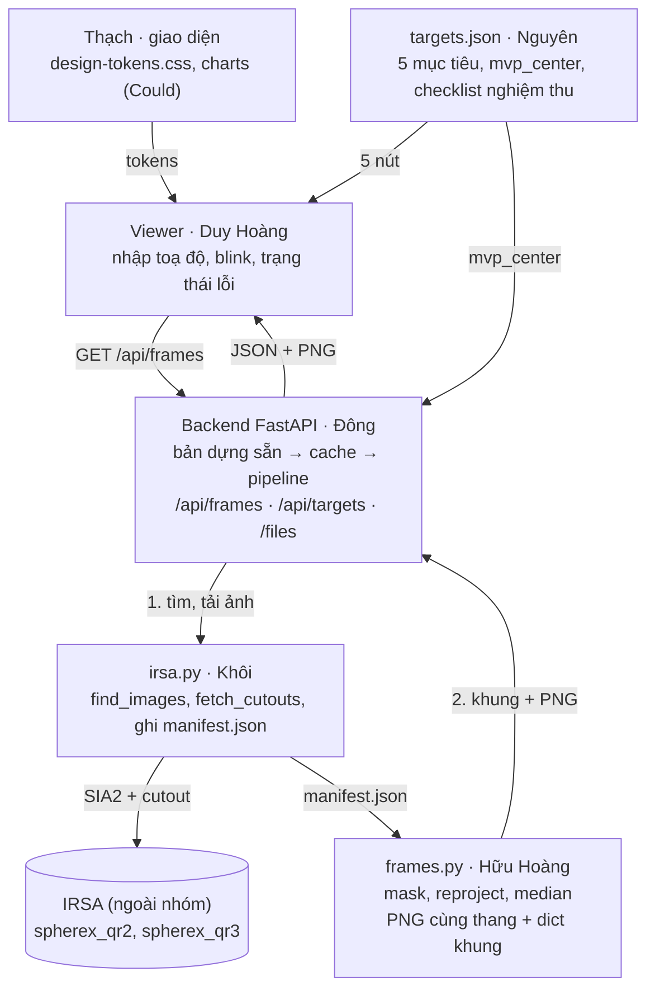

# SRS – SPHEREx Sky Viewer MVP (12/11)

Người viết: Thạch · Bản chụp ngày 9/11/2026

> Bản gốc đang được cả nhóm chỉnh sửa và bình luận tại [tài liệu SRS](https://claude.ai/artifact/KvqX1JdNRR63C4STr8v9Dp). File này là bản chụp để tra cứu trong repo; khi hai bản khác nhau, bản tài liệu là bản đúng.

## 1. Mục tiêu và phạm vi

Đến hết **12/11**, MVP làm trọn một việc: nhập một vị trí, backend tìm ảnh SPHEREx thật trên IRSA, cộng ảnh theo detector × đợt quét, và viewer blink các khung có ghi ngày chụp, cho cả 5 mục tiêu kiểm thử. Mỗi mảnh nối với mảnh kế tiếp qua một hợp đồng đã chốt (mục 5 và 6), nên ai cũng biết mình nhận gì, trả gì, và trả cho ai.

| Mức | Tính năng | Lý do |
| --- | --- | --- |
| Must | Nhập toạ độ hai dạng hoặc tên vật thể; chọn FOV, detector D1–D6 và release; tất cả lưu trong URL | Yêu cầu MVP của đề |
| Must | `/api/frames` chạy với dữ liệu thật: SIA2 → cutout → reproject → median theo detector × đợt → PNG cùng một thang độ sáng | Phần lõi của sản phẩm |
| Must | Viewer blink ảnh SPHEREx thật, ghi rõ ngày, detector, release và số ảnh đã cộng | Phần người dùng nhìn thấy |
| Must | 5 nút mục tiêu dùng toạ độ đã đẩy theo chuyển động riêng; khung của 5 mục tiêu được dựng sẵn | Barnard đã dịch khoảng 270″ so với J2000, lớn hơn cả cutout 180″; dựng sẵn để demo không phụ thuộc IRSA |
| Must | Báo lỗi rõ ràng cho `NO_DATA`, 422, 502 và 504 | Yêu cầu MVP của đề |
| Should | Ảnh hiệu đợt sau trừ đợt trước | Hữu Hoàng đã có code |
| Should | Cảnh báo sao bão hoà theo từng khung | Cần cho Barnard và R Dra |
| Should | Link công khai cho frontend và backend | Luyện deploy trước ngày thi |
| Could | Panel phổ và đường cong ánh sáng trên dữ liệu mock | Component đã có |
| Could | Bản đồ Aladin + overlay Gaia | Đã có trang riêng |
| Won't | Job bất đồng bộ, tự phát hiện vật thể, ảnh màu giả, mã nhúng | Để dành cho ngày thi hoặc bỏ |

**Luật thi:** MVP nằm trong repo đào tạo, và code không được chép sang repo dự thi. Thứ mang sang ngày thi là kỹ năng và hợp đồng API. Có được mang bản in hợp đồng vào hay không thì phải hỏi Local Lead (đã có trong checklist trước ngày thi).

**Thay đổi so với lộ trình:** 4 ngày này thay buổi diễn tập 9/11 và việc viết runbook 11/11 bằng việc xây MVP thật. Ngày đổi vai 10/11 làm ngay trên các module của MVP, và ngày 12/11 dùng để nghiệm thu và retro thay cho mini-hackathon ISS. Nhóm cần chốt việc này (mục 10).

## 2. Hiện trạng repo ngày 8/11

Các mảnh đều chạy riêng được, nhưng chưa nối với nhau: viewer đang chiếu ảnh unWISE, backend chỉ trả mock, còn đường dữ liệu SPHEREx thật nằm trong script của Hữu Hoàng. Ba nhánh chưa mở PR, nên `main` chưa có hợp đồng API và `targets.json`. Số test là kết quả chạy lại ngày 8/11 trên bản sao riêng của từng nhánh.

| Người | Đã có (nơi nằm) | Kiểm tra 8/11 | Còn thiếu cho MVP |
| --- | --- | --- | --- |
| Duy Hoàng | `main` (PR #3, #4): đọc toạ độ hai dạng và tên vật thể qua MAST, viewer blink bằng canvas, URL `q`/`fov`/`src`, nguồn ảnh unWISE và ảnh mẫu | Test JS đạt (nằm trong 173/173 của cả repo) | Nguồn ảnh SPHEREx gọi `/api/frames`; tham số detector và release; FOV 20′ vượt giới hạn 12′ của API |
| Đông | `dong/api-contract`, chưa có PR: OpenAPI v0 cho 3 endpoint; FastAPI có `/health` và 3 endpoint mock | 25/25 test đạt | Mock chỉ hỗ trợ WISE 0855 và cần file fixture tạo từ trang HTML lưu trên máy Đông, nên người khác chưa chạy được mock. Chưa có chế độ thật, chưa phục vụ PNG, chưa có cache |
| Khôi | Chưa có nhánh hay commit nào | Không có gì để chạy | Module tìm ảnh SIA2, tải cutout và ghi manifest. Phần này hiện Hữu Hoàng tự viết trong `five_targets.py` |
| Hữu Hoàng | Nhánh `huu-hoang`, chưa có PR, cập nhật 8/11: lưới TAN, `make_frames(ra, dec, fov, det)` (median theo detector × nhóm thời gian), ảnh hiệu, che flags, tự tải cutout thật cho 5 mục tiêu | 8/8 test đạt. WISE 0855: 18 cutout ra 9 ảnh median và 6 ảnh hiệu trong khoảng 3,3 giây, chưa tính thời gian tải | Đầu ra chưa theo dạng JSON của hợp đồng; các khung chưa dùng chung một thang độ sáng |
| Nguyên | `nguyen/day03-04`, chưa có PR: `shared/targets.json` (5 mục tiêu, J2000 và chuyển động riêng), bảng dịch chuyển kỳ vọng, phân loại đợt quét, hàm `propagate()` | 32/33 test. Bài hỏng vì thiếu file `observations_template.csv` chưa được commit | Toạ độ đã đẩy tới ngày chụp để cả nhóm dùng chung; checklist nghiệm thu |
| Thạch | PR #6, #7, #8 (mở ngày 9/11, merge theo thứ tự): design tokens, wireframe và hi-fi trên canvas, trang Aladin + Gaia, component biểu đồ phổ và đường cong ánh sáng | 173/173 test JS đạt. Overlay Gaia chưa chạy với VizieR thật vì máy này không vào được CDS | Đang chờ review; biểu đồ mới chạy trên dữ liệu giả |

Những điểm các phần đang lệch nhau, mục 5 sẽ chốt cách xử lý:

- **FOV:** viewer cho chọn 2′, 5′, 10′ và 20′, trong khi API chỉ nhận tối đa 0,2° (12′).
- **Detector:** viewer chưa có tham số này; API dùng chuỗi `SPHEREx-D6`, còn `make_frames` dùng số 6.
- **Release:** API cấm tự chuyển release khi không có kết quả. Ngày 3/11, QR3 trả 0 ảnh tại WISE 0855 còn QR2 trả 256 ảnh, nên mặc định phải là QR2.
- **Đợt quét:** Hữu Hoàng tách nhóm khi hai lần chụp cách nhau hơn 30 ngày; Nguyên phân đợt theo quy tắc trong tài liệu SPHEREx. Hai cách có thể cho kết quả khác nhau.
- **Toạ độ:** cả viewer lẫn backend đều cắt ảnh quanh toạ độ J2000, nên Barnard sẽ nằm ngoài khung.

## 3. Kiến trúc và luồng dữ liệu



Backend tìm bản dựng sẵn trước, rồi đến cache, nên 5 mục tiêu vẫn chạy khi IRSA chậm. Chỉ vị trí mới mới đi hết hai bước 1 và 2 qua Khôi và Hữu Hoàng. Trình duyệt chỉ nói chuyện với backend, không bao giờ gọi IRSA trực tiếp.

## 4. Yêu cầu chức năng

Mỗi yêu cầu có một người sở hữu và một người đỡ theo vòng dự phòng, nên khi một người trễ thì đã biết ai vào giúp. Yêu cầu Must phải xong trước 12/11; Should và Could chỉ làm sau khi Must đã đạt.

| ID | Yêu cầu | Mức | Sở hữu | Đỡ |
| --- | --- | --- | --- | --- |
| FR-01 | Nhập vị trí dạng độ thập phân, dạng giờ–phút–giây hoặc tên vật thể, ra RA/Dec theo độ; nhập sai thì báo lỗi ngay tại ô nhập | Must (đã có) | Duy Hoàng | Thạch |
| FR-02 | Chọn FOV 2′, 5′ hoặc 10′; detector D1–D6; release QR2 (mặc định) hoặc QR3 | Must | Duy Hoàng | Thạch |
| FR-03 | URL `?q=&fov=&det=&rel=` mở lại đúng khung nhìn đang xem | Must | Duy Hoàng | Thạch |
| FR-04 | 5 nút mục tiêu; tâm khung là vị trí đã đẩy tới giữa giai đoạn quan sát QR2 (trường `mvp_center` trong `targets.json`) | Must | Nguyên (số liệu), Duy Hoàng (giao diện) | Hữu Hoàng |
| FR-05 | Tìm ảnh qua SIA2 theo vị trí và release, lọc theo detector, tải cutout tối đa 6 ảnh cho mỗi đợt; timeout 120 giây, thử lại 3 lần; ghi manifest | Must | Khôi | Đông |
| FR-06 | Che pixel lỗi theo flags, reproject về lưới TAN quanh tâm yêu cầu, lấy median theo detector × đợt, xuất PNG asinh với cùng `vmin`/`vmax` cho mọi khung | Must | Hữu Hoàng | Khôi |
| FR-07 | Backend kiểm tra đầu vào, gọi FR-05 rồi FR-06, cache theo khoá truy vấn, phục vụ PNG, trả JSON đúng hợp đồng v1 | Must | Đông | Duy Hoàng |
| FR-08 | Viewer blink các khung theo thời gian; trên ảnh ghi ngày, detector và đợt; bên cạnh ghi release, số ảnh đã cộng; có play, pause, tốc độ và thanh trượt khung | Must | Duy Hoàng | Thạch |
| FR-09 | Hiển thị trạng thái đang tải, `NO_DATA`, lỗi 422 kèm tên trường sai, 502, 504 và nhãn dữ liệu mock | Must | Duy Hoàng | Đông |
| FR-10 | Dựng sẵn khung cho 5 mục tiêu × 6 detector; backend trả từ bản dựng sẵn mà không gọi IRSA | Must | Khôi (dựng), Đông (phục vụ) | Hữu Hoàng |
| FR-11 | Ảnh hiệu đợt sau trừ đợt trước, có nút bật/tắt | Should | Hữu Hoàng (ảnh), Duy Hoàng (nút) | Nguyên |
| FR-12 | Cảnh báo theo từng khung: `SATURATED` khi có pixel bão hoà gần tâm, `LOW_COVERAGE` khi khung thiếu nhiều pixel | Should | Hữu Hoàng | Nguyên |
| FR-13 | Deploy frontend và backend lên link công khai | Should | Duy Hoàng | Đông |
| FR-14 | Panel phổ và đường cong ánh sáng chạy trên mock | Could | Thạch | Nguyên |
| FR-15 | Bản đồ Aladin + overlay Gaia cạnh viewer | Could | Thạch | Duy Hoàng |

FR-02 bỏ lựa chọn 20′ để khớp giới hạn 12′ của API. FR-05 dùng cách tải mà Hữu Hoàng đã viết trong `five_targets.py`, nên Khôi chuyển code đó vào module dùng chung chứ không phải viết lại từ đầu.

## 5. Hợp đồng API v1

v1 giữ nguyên `openapi.yaml` v0 của Đông (tên trường lấy theo cột SIA2 thật) và chỉ **thêm** trường, không đổi tên hay xoá trường nào. Sau 22:30 ngày 9/11, mọi thay đổi phải qua PR và cần Đông, Duy Hoàng và Hữu Hoàng cùng duyệt. Được thêm trường mới, không được đổi tên.

| Endpoint | Tham số bắt buộc | Trả về | Trạng thái MVP |
| --- | --- | --- | --- |
| `GET /health` | không có | `{"status": "ok"}` | Đã có |
| `GET /api/targets` | không có | Danh sách 5 mục tiêu: `id`, `name`, `object_type`, `ra_deg`, `dec_deg`, `epoch_jyear`, `default_detector`, `default_fov_arcmin` | Mới, Must |
| `GET /api/frames` | `s_ra`, `s_dec`, `obs_collection`, `energy_bandpassname`, `cutout_size_deg` | Các khung PNG, nguồn ảnh, cảnh báo | v0 + các trường mới bên dưới, Must |
| `GET /files/{path}` | không có | Ảnh PNG mà `image_url` trỏ tới | Mới, Must |
| `GET /api/spectrum`, `GET /api/lightcurve` | Giữ như v0 | Giữ như v0 | Chỉ cần mock, Could |

### Quy ước đầu vào

- **FOV:** frontend gửi `cutout_size_deg` = FOV (phút cung) / 60, tức 2′ → 0,0333, 5′ → 0,0833, 10′ → 0,1667. Giới hạn tối đa 0,2° của v0 được giữ.
- **Detector:** API luôn dùng chuỗi `SPHEREx-D1` đến `SPHEREx-D6`. URL của frontend viết gọn `det=D6`, còn code Python nội bộ được dùng số, nhưng chuỗi trong JSON chỉ có một dạng.
- **Release:** frontend mặc định `spherex_qr2`. Backend không tự đổi release khi không có kết quả (giữ luật của v0), mà trả `NO_DATA` để frontend gợi ý đổi release.
- **Toạ độ:** `s_ra`/`s_dec` là tâm khung, ICRS theo độ. Với 5 mục tiêu, frontend lấy tâm từ `/api/targets` (đã đẩy theo chuyển động riêng); với toạ độ người dùng gõ, dùng nguyên giá trị đó.

### Trường mới trong phản hồi `/api/frames`

| Trường | Kiểu | Ý nghĩa | Ai điền |
| --- | --- | --- | --- |
| `frames[]` | mảng | Xếp theo `t_min` tăng dần; mỗi khung là một detector trong một đợt | Hữu Hoàng |
| `frames[].visit_index` | số nguyên, từ 0 | Thứ tự đợt theo thời gian | Hữu Hoàng |
| `frames[].visit_label` | chuỗi | Nhãn hiển thị, ví dụ `Visit 1` | Hữu Hoàng |
| `grid` | object | `projection` = `TAN`, `center_ra_deg`, `center_dec_deg`, `pixel_scale_arcsec`, `width_px`, `height_px`. Mọi khung cùng một lưới, nên overlay và Aladin khớp được với ảnh | Hữu Hoàng |
| `display` | object | `stretch` = `asinh`, `vmin`, `vmax`, `unit` = `MJy/sr`. Mọi khung dùng chung một thang, nên blink không nhấp nháy giả | Hữu Hoàng |
| `difference_frames[]` | mảng, có thể rỗng | Mỗi phần tử gồm `frame_id`, `image_url`, `later_frame_id`, `earlier_frame_id`, `warnings` (Should) | Hữu Hoàng |

### Mã cảnh báo và mã lỗi

Cảnh báo không chặn kết quả: HTTP vẫn là 200 và frontend hiển thị câu `message`. Lỗi thì chặn kết quả và trả về `{"error": {"code", "message", "fields"}}` như trong v0.

| Mã | Nơi xuất hiện | Khi nào | Frontend làm gì |
| --- | --- | --- | --- |
| `NO_DATA` | `warnings` của phản hồi | Không có ảnh nào phù hợp | Hiện thông báo, gợi ý đổi detector, FOV hoặc release |
| `SINGLE_VISIT` | `warnings` của phản hồi | Chỉ có một đợt nên không có gì để blink | Hiện một khung kèm lời giải thích |
| `PREBUILT` | `warnings` của phản hồi | Kết quả lấy từ bản dựng sẵn, không hỏi IRSA | Ghi nhỏ nguồn dữ liệu |
| `PARTIAL_DOWNLOAD` | `warnings` của phản hồi | Một số cutout tải lỗi và bị bỏ qua | Hiện cảnh báo |
| `MOCK_DATA` | `warnings` của phản hồi | Dữ liệu giả, kèm `data_kind` = `mock` | Hiện nhãn mock trên ảnh |
| `SATURATED` | `frames[].warnings` | Có pixel bão hoà (flag OVERFLOW) gần tâm khung | Hiện cảnh báo trên khung đó |
| `LOW_COVERAGE` | `frames[].warnings` | Khung thiếu nhiều pixel hợp lệ | Hiện cảnh báo trên khung đó |
| `VALIDATION_ERROR` | HTTP 422 | Tham số sai; `fields` nêu tên tham số | Hiện lỗi cạnh ô nhập tương ứng |
| `UPSTREAM_ERROR` | HTTP 502 | IRSA trả lỗi | Nút thử lại |
| `UPSTREAM_TIMEOUT` | HTTP 504 | IRSA quá thời gian | Nút thử lại và nút mở 5 mục tiêu dựng sẵn |
| `PROCESSING_ERROR` | HTTP 500 | Lỗi khi xử lý ảnh | Hiện lỗi, báo nhóm |

**Thời gian:** mỗi request được xử lý đồng bộ. Backend dừng sau tối đa 120 giây và trả 504. Frontend báo "đang chậm" sau 30 giây và huỷ request sau 150 giây. Job bất đồng bộ nằm ngoài phạm vi MVP.

### Ví dụ phản hồi

Số liệu dưới đây chỉ để minh hoạ cấu trúc, không phải phép đo thật. Các trường có sẵn từ v0 được rút gọn.

```json
{
  "data_kind": "observational",
  "query": { "s_ra": 133.7951, "s_dec": -7.2451, "obs_collection": "spherex_qr2",
             "energy_bandpassname": "SPHEREx-D6", "cutout_size_deg": 0.0833 },
  "grid": { "projection": "TAN", "center_ra_deg": 133.7951, "center_dec_deg": -7.2451,
            "pixel_scale_arcsec": 6.2, "width_px": 49, "height_px": 49 },
  "display": { "stretch": "asinh", "vmin": 0.1, "vmax": 2.5, "unit": "MJy/sr" },
  "frames": [
    { "frame_id": "wise0855-D6-v0", "image_url": "/files/frames/wise0855-D6-v0.png",
      "visit_index": 0, "visit_label": "Visit 1",
      "t_min": 60812.4, "t_max": 60816.9, "observation_time": "2025-05-19T15:36:00Z",
      "energy_bandpassname": "SPHEREx-D6", "obs_collection": "spherex_qr2",
      "n_images": 4, "source_obs_publisher_dids": ["ivo://…", "…"], "warnings": [] }
  ],
  "difference_frames": [],
  "sources": [ "… như v0 …" ],
  "warnings": []
}
```

## 6. Hợp đồng giữa các mảng

Code dùng chung nằm trong `shared/pipeline/` (Python) và `shared/` (frontend), theo đúng luật của repo. Mỗi mảnh chỉ gọi mảnh kế tiếp qua đúng một hàm và một định dạng file, nên có thể làm song song trên dữ liệu giả rồi thay bằng phần thật.

| Bàn giao | Người giao → người nhận | Định dạng | Thay tạm bằng gì khi chưa có |
| --- | --- | --- | --- |
| Tìm và tải ảnh | Khôi → Hữu Hoàng, Đông | `shared/pipeline/irsa.py` và `manifest.json` | `five_targets.py` của Hữu Hoàng |
| Dựng khung | Hữu Hoàng → Đông | `shared/pipeline/frames.py`: dict theo hợp đồng và file PNG | Mock của Đông |
| API | Đông → Duy Hoàng, Thạch | HTTP theo mục 5 | Mock v1 chạy không cần file fixture |
| Mục tiêu | Nguyên → Đông, Duy Hoàng | `shared/targets.json` có thêm `mvp_center` | `coords/targets.js` (J2000) |
| Giao diện | Thạch → Duy Hoàng | `shared/design-tokens.css`, `shared/charts/` | Style sẵn có trong viewer |

### Khôi: `shared/pipeline/irsa.py`

```python
def find_images(ra_deg, dec_deg, collection, detector, t_min=None, t_max=None) -> list[dict]:
    """SIA2 query. Each dict keeps the SIA2 column names: obs_id, obs_publisher_did,
    obs_collection, energy_bandpassname, t_min, t_max, access_url.
    detector is "SPHEREx-D1".."SPHEREx-D6". Raises UpstreamError / UpstreamTimeout."""

def fetch_cutouts(images, ra_deg, dec_deg, size_deg, out_dir, *, max_per_visit=6,
                  timeout_s=120, retries=3) -> Path:
    """Downloads {access_url}?center=ra,dec&size=deg into out_dir and writes
    out_dir/manifest.json. Skips failed cutouts and records them. Returns the manifest path."""
```

`manifest.json` dùng đúng các trường mà `make_frames` của Hữu Hoàng đang đọc, chỉ thêm trường mới:

```json
{ "query": { "ra_deg": 133.7951, "dec_deg": -7.2451, "collection": "spherex_qr2", "size_deg": 0.0833 },
  "failed": [ { "obs_id": "…", "reason": "timeout" } ],
  "entries": [ { "obs_id": "…", "obs_publisher_did": "ivo://…", "detector": "D6",
                 "mjd": 60812.4, "t_max": 60812.5, "path": "data/cache/…/x.fits", "sha256": "…" } ] }
```

### Hữu Hoàng: `shared/pipeline/frames.py`

```python
def make_frames(ra_deg, dec_deg, fov_deg, detector, manifest_path, out_dir, *,
                gap_days=30) -> dict:
    """Masks flags, reprojects to a TAN grid centred on (ra, dec), medians per visit,
    writes PNGs with one shared asinh vmin/vmax. Returns {frames, difference_frames,
    grid, display, warnings}, with the field names of section 5. image paths are
    relative to out_dir; the backend turns them into /files/… URLs."""
```

### Đông: backend

- Khoá cache: `(round(ra, 4), round(dec, 4), size_deg, detector, collection)`. Thư mục cache là `data/cache/<khoá>/`, bản dựng sẵn nằm trong `data/prebuilt/<target_id>/<D>/`.
- Trước hết tìm trong bản dựng sẵn, rồi đến cache, cuối cùng mới gọi `irsa` và `frames`.
- Biến môi trường `API_MODE=mock|real`. Mock v1 phải chạy được với mọi toạ độ mà không cần file fixture trên máy Đông.
- Một test kiểm tra phản hồi của cả hai chế độ đều khớp với `openapi.yaml` v1.

### Nguyên: `shared/targets.json`

Thêm vào mỗi mục tiêu trường `mvp_center` = `{ra_deg, dec_deg, epoch_jyear, method}`, tính bằng `propagate()` tới khoảng giữa giai đoạn quan sát QR2 (MJD 60800–61174, tức 5/2025–5/2026). Thêm `default_detector` và `default_fov_arcmin` cho từng mục tiêu, ví dụ WISE 0855 là D6, còn Epsilon Indi cần FOV đủ rộng để thấy cả A và B.

### Duy Hoàng: frontend

Thêm nguồn `spherex` vào `sky-viewer/src/sources.js` theo đúng khuôn `load({raDeg, decDeg, fovArcmin}, {signal})` đã có. Nguồn này gọi `/api/frames`, tải trước PNG và trả về các khung cho `BlinkViewer`, gồm cả nhãn đợt và cảnh báo. Nguồn unWISE vẫn được giữ làm phương án dự phòng khi IRSA sập.

## 7. Yêu cầu phi chức năng

| ID | Yêu cầu | Cách kiểm |
| --- | --- | --- |
| NFR-01 | Mục tiêu dựng sẵn trả kết quả trong dưới 2 giây; vị trí mới trả kết quả hoặc lỗi 504 trong tối đa 120 giây | Đông ghi log thời gian của từng bước |
| NFR-02 | Sao đứng yên không dịch quá 1 pixel giữa các khung | Kiểm tra tâm sao như bài A của Hữu Hoàng, Nguyên xác nhận |
| NFR-03 | Mọi khung cùng lưới, cùng kích thước và cùng `vmin`/`vmax` | Test tự động trên `grid` và `display` |
| NFR-04 | Khi IRSA không vào được, 5 mục tiêu vẫn chạy từ bản dựng sẵn | Ngắt mạng rồi bấm lần lượt 5 nút |
| NFR-05 | Mọi khung ghi rõ nguồn ảnh (`source_obs_publisher_dids`); dữ liệu giả luôn mang nhãn mock | Test hợp đồng của Đông |
| NFR-06 | Giao diện bằng tiếng Anh, dùng design tokens, nút cao tối thiểu 44px, dùng được bằng bàn phím, không cuộn ngang ở bề rộng 390px | Thạch kiểm theo QA matrix |
| NFR-07 | Mỗi module có test và README một trang ghi cách chạy; README này dùng luôn làm runbook | Người đỡ tự chạy lại được trong ngày đổi vai |
| NFR-08 | Không commit file FITS, cache hay `.env`; mỗi PR nhỏ và có người review | `.gitignore` và PR template |

## 8. Vai trò và kế hoạch 9–12/11

Ngày đầu chốt hợp đồng và cho mỗi người một đầu vào giả để không ai phải chờ; ngày thứ hai thay dữ liệu giả bằng dữ liệu thật; ngày thứ ba chạy đầu–cuối cho 5 mục tiêu; ngày cuối nghiệm thu. Giờ làm việc và luật 30 phút giữ như lộ trình.

| Người | 9/11 (T2): chốt hợp đồng | 10/11 (T3): dữ liệu thật | 11/11 (T4): đầu–cuối | 12/11 (T5): nghiệm thu |
| --- | --- | --- | --- | --- |
| Cả nhóm | 19:30–20:00 duyệt SRS và hợp đồng v1; merge các nhánh đang mở | Đổi vai 90 phút: mỗi người chạy module của người mình đỡ, chỉ dùng README | Sửa lỗi theo issue | Chạy checklist mục 9, demo 5 phút, retro |
| Đông | Merge PR hợp đồng; cập nhật `openapi.yaml` lên v1; mock v1 chạy với mọi toạ độ và trả PNG giả; thêm `/api/targets` | `API_MODE=real`: dựng sẵn → cache → `irsa` → `frames`; phục vụ `/files`; log thời gian | Deploy backend cùng Duy Hoàng (Should); test hợp đồng | Ghi bản hợp đồng cuối để cả nhóm học thuộc trước ngày thi |
| Khôi | Ngồi cùng Hữu Hoàng 30 phút, chuyển code tải ảnh vào `shared/pipeline/irsa.py`; chạy cho Barnard ra `manifest.json` | Script dựng sẵn 5 mục tiêu × 6 detector vào `data/prebuilt/`, đưa lên drive | Giả lập IRSA sập, kiểm bản dựng sẵn vẫn chạy | Trình bày luồng dữ liệu trong demo |
| Hữu Hoàng | Mở PR nhánh `huu-hoang`; chuyển `make_frames` vào `shared/pipeline/frames.py`, trả dict theo mục 5, dùng chung một thang độ sáng | `difference_frames`; cảnh báo `SATURATED` và `LOW_COVERAGE` | Giảm thời gian hoặc RAM nếu một request vượt 120 giây | Giải thích ảnh và ảnh hiệu trong demo |
| Nguyên | Mở PR và commit file template còn thiếu; thêm `mvp_center`, `default_detector`, `default_fov_arcmin` | Đối chiếu khung Barnard và WISE 0855 với bảng kỳ vọng | Chạy checklist mục 9 lần 1 | Chủ trì nghiệm thu |
| Duy Hoàng | Nguồn `spherex` gọi mock v1; thêm `det` và `rel`; FOV chỉ còn 2′, 5′, 10′ | Đủ các trạng thái lỗi ở mục 5; nhãn đợt và ngày; chuyển sang API thật | Deploy frontend (Should); nút ảnh hiệu | Chạy demo |
| Thạch | Mở PR cho tokens, Aladin và biểu đồ; viết QA matrix từ mục 9; theo dõi các mốc | Kiểm tra giao diện; ghép panel phổ nếu Must đã đạt | Kiểm tra ở bề rộng 390px; cập nhật SRS | Ghi kết quả nghiệm thu, quyết Go/No-Go |

**Mốc kiểm tra (22:30 mỗi ngày):**

- [ ] **9/11:** `openapi.yaml` v1 đã vào `main`; Duy Hoàng chạy được mock v1 trên máy mình.
- [ ] **10/11:** một mục tiêu chạy đầu–cuối bằng dữ liệu thật trên ít nhất một máy.
- [ ] **11/11:** toàn bộ mục Must trong checklist mục 9 đạt.
- [ ] **12/11:** nghiệm thu xong, bản hợp đồng cuối đã ghi lại.

Trượt mốc 9/11 thì đầu ngày 10/11 cả nhóm dừng 20 phút để chốt hợp đồng trước. Trượt mốc 10/11 thì Đông ngồi cùng Khôi, Nguyên ngồi cùng Hữu Hoàng, còn Duy Hoàng tiếp tục với mock.

## 9. Tiêu chí nghiệm thu

MVP đạt khi tất cả các mục Must dưới đây đạt trên một máy không phải máy của người viết code. Nguyên chủ trì, Thạch ghi kết quả. Sai số cho phép của dịch chuyển do Nguyên chốt trước ngày 11/11.

Bảng chạy thử có cột kết quả cho từng dòng: [QA matrix](QA-matrix.md)

**5 mục tiêu (Must):**

- [ ] **WISE 0855, D6:** có ít nhất 2 khung khác đợt, mỗi khung ghi ngày và detector; sao nền không dịch quá 1 pixel.
- [ ] **Barnard:** ngôi sao nằm trong khung; dịch chuyển giữa hai đợt khớp bảng kỳ vọng của Nguyên (file expected\_motion\_between\_surveys.csv ghi khoảng 0,9–1,0 pixel 6,15″ giữa hai đợt cách nhau khoảng nửa năm).
- [ ] **Epsilon Indi B:** khung tải được với FOV mặc định trong `targets.json`, đúng nguồn B chứ không nhầm sang A.
- [ ] **RW Aurigae:** khung tải được và ghi đủ nguồn ảnh. Độ sáng thay đổi chỉ được xác nhận khi có đường cong ánh sáng, nằm ngoài MVP.
- [ ] **R Draconis:** khung tải được; nếu có pixel bão hoà thì hiện cảnh báo `SATURATED` (Should).

**Hành vi chung (Must):**

- [ ] Nhập `133.7951 -7.2451` và `08h55m10.831s -07d14m42.53s` cho ra cùng một vị trí.
- [ ] Một toạ độ ngoài 5 mục tiêu trả về khung hoặc `NO_DATA` trong vòng 120 giây.
- [ ] Ngắt mạng tới IRSA thì 5 mục tiêu vẫn chạy, còn vị trí mới báo lỗi 502 hoặc 504 kèm nút thử lại.
- [ ] Nhập sai thì nhận lỗi 422, và thông báo nêu đúng ô bị sai.
- [ ] Tải lại trang với URL đang xem thì mở lại đúng vị trí, FOV, detector và release.
- [ ] Phản hồi của cả chế độ mock và chế độ thật đều khớp với `openapi.yaml` v1 (test tự động).
- [ ] Mỗi module có README, và người đỡ đã tự chạy lại được trong ngày đổi vai.

**Should:**

- [ ] Bật ảnh hiệu thì thấy Barnard thành một cặp sáng–tối.
- [ ] Link công khai mở được ở tab ẩn danh trên một máy khác.

## 10. Rủi ro và câu hỏi mở

| Rủi ro | Dấu hiệu sớm | Cách xử lý |
| --- | --- | --- |
| Khôi chưa có commit nào, trong khi mảng dữ liệu nằm trên đường lõi | 22:30 ngày 9/11 chưa có `irsa.py` | Code tải ảnh đã có trong `five_targets.py`; Khôi ngồi cùng Hữu Hoàng ngay từ ngày 9/11 |
| Ba nhánh chưa merge, nên `main` chưa có hợp đồng | PR còn mở quá một ngày | Merge xong trong buổi tối 9/11 trước khi làm việc mới; Duy Hoàng giữ `main` luôn chạy được |
| IRSA chậm hoặc sập | Một request vượt 30 giây | Bản dựng sẵn 5 mục tiêu (FR-10); nguồn unWISE làm dự phòng cuối cùng |
| QR3 chưa phủ một số mục tiêu | Truy vấn QR3 trả `NO_DATA` | Mặc định QR2; người dùng tự chọn QR3 |
| Không vào được CDS (Aladin, Gaia) từ một số mạng | Bản đồ trời màu xám | Aladin chỉ ở mức Could, viewer chính không phụ thuộc CDS |
| Thiếu giờ: mỗi ngày thường chỉ khoảng 3 giờ | Mốc 10/11 trượt | Cắt Should và Could, giữ nguyên Must |
| Request vượt 120 giây vì tải quá nhiều ảnh | Log của Đông | Giảm `max_per_visit` hoặc FOV |

**Câu hỏi mở, cần chốt trong standup 9/11:**

1. Nhóm đồng ý thay lịch 9–12/11 của lộ trình bằng kế hoạch ở mục 8 không? Nếu đồng ý, mini-hackathon ISS ngày 12/11 bị bỏ.
2. Chia đợt theo khoảng cách 30 ngày (Hữu Hoàng) hay theo quy tắc trong tài liệu SPHEREx (Nguyên)? Đề xuất: MVP dùng cách 30 ngày vì đã có test, Nguyên kiểm xem hai cách có cho cùng kết quả trên 5 mục tiêu không.
3. Detector và FOV mặc định cho từng mục tiêu là gì? Nguyên chốt.
4. Có deploy ngay trong MVP không, hay chỉ chạy trên máy?
5. Local Lead có cho mang bản in hợp đồng API vào ngày thi không?

## 11. Nguồn

- [Repo dự án (đào tạo)](https://github.com/HoangKhoi1704/NASA-space-challenges-PlanetXvsSphereX) và các nhánh đã rà soát ngày 8/11: [main](https://github.com/HoangKhoi1704/NASA-space-challenges-PlanetXvsSphereX/tree/main), [dong/api-contract](https://github.com/HoangKhoi1704/NASA-space-challenges-PlanetXvsSphereX/tree/dong/api-contract), [huu-hoang](https://github.com/HoangKhoi1704/NASA-space-challenges-PlanetXvsSphereX/tree/huu-hoang), [nguyen/day03-04](https://github.com/HoangKhoi1704/NASA-space-challenges-PlanetXvsSphereX/tree/nguyen/day03-04)
- [Hợp đồng API v0 (openapi.yaml)](https://github.com/HoangKhoi1704/NASA-space-challenges-PlanetXvsSphereX/blob/dong/api-contract/shared/api-contract/openapi.yaml) và [README hợp đồng](https://github.com/HoangKhoi1704/NASA-space-challenges-PlanetXvsSphereX/blob/dong/api-contract/shared/api-contract/README.md)
- [Bảng kỳ vọng v0 của Nguyên (ANALYSIS.md)](https://github.com/HoangKhoi1704/NASA-space-challenges-PlanetXvsSphereX/blob/nguyen/day03-04/members/nguyen/day03-04/ANALYSIS.md)
- [Nhật ký xử lý ảnh của Hữu Hoàng (TASKS.md)](https://github.com/HoangKhoi1704/NASA-space-challenges-PlanetXvsSphereX/blob/huu-hoang/members/huu-hoang/TASKS.md)
- [Lộ trình 6 thành viên](https://claude.ai/artifact/WqE93SyHj1Coz4vbgXLPj6)
- [Wireframe và hi-fi trên canvas](https://claude.ai/artifact/VBXLCcekrq3vHwPDUFBpjV)
- [SPHEREx Data Access – IRSA](https://caltech-ipac.github.io/spherex-archive-documentation/spherex-data-access) và [SPHEREx Cutout Capabilities](https://irsa.ipac.caltech.edu/data/SPHEREx/docs/cutout_tool.html)
