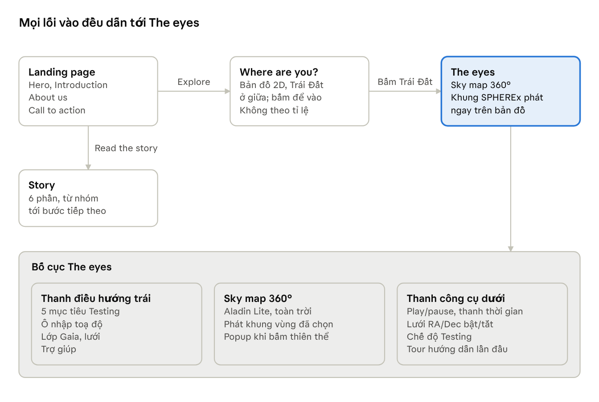
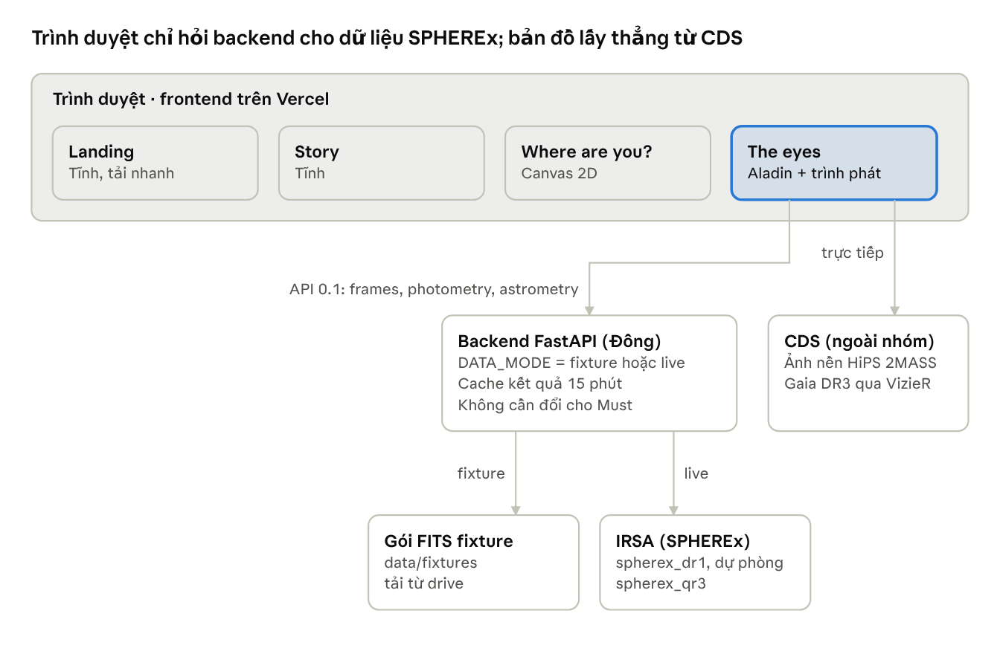

# SRS v2 – SPHEREx Sky Viewer: website kể chuyện và sky map 360°

Người viết: Thạch · Bản chụp ngày 14/11/2026

> Bản gốc đang được nhóm chỉnh sửa và bình luận tại [tài liệu SRS v2](https://claude.ai/artifact/5wmLU91AsxEcF7RwKZ8PdH). File này là bản chụp để tra cứu trong repo; khi hai bản khác nhau, bản tài liệu là bản đúng. SRS của MVP (12/11) vẫn giữ ở [SRS-MVP.md](SRS-MVP.md).

## 1. Mục tiêu và phạm vi

SRS v2 nâng MVP từ một trang xem blink một vùng nhỏ thành website 4 trang: **Landing**, **Story**, **Where are you?** và **The eyes** (sky map 360°). Hợp đồng API 0.1 và các thành phần đã chạy (viewer blink, bản đồ Aladin, biểu đồ photometry, URL, zoom) được giữ và dùng lại.

**Cách hiểu “sky map video 360°” trong tài liệu này:** bản đồ 360° là bầu trời tĩnh người dùng kéo, xoay, phóng to. “Video” là chuỗi khung SPHEREx của **vùng đang chọn**, phát chồng lên đúng vị trí đó trên bản đồ. Không có video SPHEREx cho cả bầu trời (lý do ở mục 7).

| Mức | Tính năng | Ghi chú |
| --- | --- | --- |
| Must | Landing page: Hero, Introduction, About us, Call to action | Trang vào đầu tiên |
| Must | The eyes: sky map 360°, thanh điều hướng bên trái, thanh công cụ bên dưới | Trang chính |
| Must | Công cụ: hướng dẫn lần đầu, bật/tắt lưới RA/Dec, nhập toạ độ, chế độ Testing cho 5 mục tiêu, popup thông tin | Theo user flow |
| Must | Trình phát khung SPHEREx của vùng đang chọn: play/pause, phát lại, nhảy tới một thời điểm | Dùng lại viewer blink |
| Should | Where are you?: bản đồ 2D động, Trái Đất ở giữa, bấm vào để sang The eyes | Ấn tượng đầu tiên |
| Should | Story: 6 phần, từ dự án và nhóm tới bước tiếp theo | Nội dung trình bày |
| Should | Chế độ live cho toạ độ bất kỳ (backend đã có từ 13/11) | Phụ thuộc mạng tới IRSA |
| Could | Ghép nhiều cutout để phát một vùng rộng hơn 0,3° | Tốn thời gian tải |
| Could | Mô phỏng chuyển động riêng của sao Gaia trên cả bản đồ | Phải ghi nhãn “mô phỏng” |
| Could | Đánh dấu ứng viên vật thể chuyển động từ ảnh hiệu | Phải ghi nhãn “chưa kiểm chứng” |
| Won't | Video SPHEREx thật cho toàn bầu trời; tự phát hiện thiên thể đã được xác nhận | Ngoài khả năng dữ liệu và thời gian |

Mức ưu tiên trong bảng là đề xuất của Thạch, cần nhóm chốt (mục 12).

## 2. Người dùng và hành trình

Người dùng chính là học sinh, sinh viên, người yêu thiên văn và ban giám khảo: họ cần thấy sao chuyển động mà không phải biết FITS hay IRSA. Landing là cửa vào; Where are you? và Story là hai nhánh, đều dẫn tới trang chính The eyes.

Landing có thêm lối tắt vào thẳng The eyes ở chế độ Testing (LP-04). Mỗi trang có URL riêng nên mở lại hoặc chia sẻ được.

## 3. Landing page

Landing page trả lời trong một lần cuộn: trang này làm gì, vì sao đáng xem, ai làm, và bấm vào đâu để bắt đầu.

| ID | Yêu cầu | Mức | Sở hữu |
| --- | --- | --- | --- |
| LP-01 | **Hero:** tên sản phẩm, một câu nói giá trị (ví dụ “Watch nearby stars move across the sky”), nền trời sao. Nút chính “Explore the sky” sang Where are you?; nút phụ “Read the story” sang Story | Must | Thạch |
| LP-02 | **Introduction:** chúng ta làm gì và để làm gì, trong 3 thẻ ngắn: ảnh SPHEREx thật từ NASA, blink để thấy sao chuyển động, sky map để biết mình đang nhìn đâu | Must | Thạch |
| LP-03 | **About us:** 6 thành viên, mỗi người một dòng vai trò (Thạch, Đông, Duy Hoàng, Khôi, Hữu Hoàng, Nguyên); link GitHub của dự án | Must | Thạch |
| LP-04 | **Call to action:** lặp lại nút “Explore the sky” ở cuối trang, kèm link nhanh tới 5 mục tiêu (mở thẳng The eyes ở chế độ Testing) | Must | Thạch |
| LP-05 | Thanh đầu trang có link tới 4 trang; mỗi trang có URL riêng (`/`, `/story`, `/where`, `/eyes`) để chia sẻ và tải lại được | Must | Duy Hoàng |
| LP-06 | Landing tải nhanh: không tải Aladin, Plotly hay ảnh FITS; chỉ tải khi vào The eyes | Must | Duy Hoàng |

Nút “Explore the sky” có thể bỏ qua Where are you? để vào thẳng The eyes khi trang đó chưa xong (nó ở mức Should).

## 4. Story

Story là bài trình bày dạng một trang cuộn, 6 phần theo thứ tự của user flow, dùng làm nội dung khi demo với ban giám khảo. Mọi con số trên trang phải có nguồn trong repo hoặc từ NASA/IRSA.

| ID | Phần | Nội dung cần có | Nguồn | Mức | Sở hữu |
| --- | --- | --- | --- | --- | --- |
| ST-01 | Project and team | Tên dự án, đề thi NASA Space Apps, 6 thành viên và vai trò | README, trang vai trò trên wiki | Should | Thạch |
| ST-02 | Problem and users | Ảnh SPHEREx công khai nhưng khó dùng với người không chuyên; người dùng: học sinh, sinh viên, người yêu thiên văn, giám khảo | Đề thi, SRS MVP | Should | Thạch |
| ST-03 | Proposed solution | Blink các khung theo thời gian, sky map để định vị, biểu đồ độ sáng; ảnh chụp màn hình The eyes | Ứng dụng đang chạy | Should | Thạch |
| ST-04 | NASA data | SPHEREx (IRSA, collection `spherex_dr1`, dự phòng `spherex_qr3`), Gaia DR3, nền 2MASS; cách lấy cutout | `.env.example`, README của Đông và Khôi | Should | Khôi |
| ST-05 | Validation and impact | Kết quả QA matrix; Barnard: `pmdec` đúng dấu Gaia nhưng `pmra` trái dấu; R Dra: ảnh thật bị bão hoà nên chưa có flux hợp lệ | QA matrix, bàn giao Issue #36 của Nguyên | Should | Nguyên |
| ST-06 | Next steps | Phát hiện ứng viên chuyển động, vùng rộng hơn, nhiều đợt chụp hơn | Mục 1 và 7 của SRS này | Should | Thạch |

Phần Validation nói đúng cả điều chưa đạt: giám khảo tin một đội nêu giới hạn hơn một đội chỉ nói điểm mạnh.

## 5. Where are you? (ấn tượng đầu tiên)

Trang này cho người dùng biết họ đang đứng ở đâu trước khi nhìn ra bầu trời: Trái Đất ở giữa màn hình, các hành tinh và trời sao chuyển động quanh, bấm Trái Đất để sang The eyes.

| ID | Yêu cầu | Mức | Sở hữu |
| --- | --- | --- | --- |
| WH-01 | Hoạt cảnh 2D (canvas hoặc SVG): Trái Đất ở tâm, các hành tinh trên quỹ đạo quanh, nền sao chuyển động chậm | Should | Khôi |
| WH-02 | Trái Đất là một nút: bấm, chạm hoặc nhấn Enter thì chuyển sang The eyes; có chữ gợi ý “You are here. Click Earth to look out” | Should | Khôi |
| WH-03 | Di chuột lên một hành tinh thì hiện tên; hành tinh khác không dẫn sang trang nào | Could | Khôi |
| WH-04 | Ghi chú nhỏ “Not to scale”: cảnh nhìn từ Trái Đất là cách minh hoạ, không phải vị trí thật của các hành tinh | Should | Thạch |
| WH-05 | Nút “Skip” vào thẳng The eyes; tắt chuyển động khi trình duyệt bật `prefers-reduced-motion` | Should | Khôi |

Nhánh `khoi/celestial-sphere-3d-demo` của Khôi (đẩy lên ngày 14/11) có thể dùng lại cho trang này; Thạch chưa xem nội dung nhánh đó.

## 6. The eyes (trang chính)

The eyes là bầu trời 360° chiếm gần hết màn hình: thanh điều hướng bên trái, thanh công cụ bên dưới, và trình phát khung SPHEREx hiện ngay tại vùng đang chọn trên bản đồ.

**Bố cục**

- **Bản đồ 360°:** Aladin Lite (đã có trong `shared/skymap/`) ở chế độ toàn trời, kéo để xoay, cuộn để phóng to.
- **Thanh điều hướng trái (đóng mở được):** danh sách 5 mục tiêu, ô nhập toạ độ, lớp hiển thị (Gaia, lưới), trợ giúp.
- **Thanh công cụ dưới:** trình phát (play/pause, thanh thời gian, tốc độ), bật/tắt lưới RA/Dec, nút Testing, nút xem lại hướng dẫn.

| ID | Yêu cầu | Mức | Sở hữu |
| --- | --- | --- | --- |
| EY-01 | Bản đồ toàn trời mở ở vị trí trong URL, nếu không có thì ở mục tiêu đầu tiên; phóng từ cả bầu trời xuống vài phút cung | Must | Thạch |
| EY-02 | **Hướng dẫn lần đầu:** 4–5 bước chỉ vào bản đồ, thanh trái, trình phát, ô toạ độ; có nút bỏ qua; chỉ hiện tự động lần đầu (ghi nhớ trong trình duyệt), xem lại bằng nút “Tour” | Must | Thạch |
| EY-03 | **Lưới RA/Dec:** nút bật/tắt lưới toạ độ trên bản đồ; trạng thái nằm trong URL | Must | Thạch |
| EY-04 | **Trình phát:** chọn một vùng (bấm mục tiêu hoặc nhập toạ độ) thì tải `/api/frames` và phát các khung chồng lên đúng vị trí, đúng kích thước trên bản đồ (theo `grid.center_ra`, `center_dec`, `pixscale_arcsec`) | Must | Duy Hoàng |
| EY-05 | Trình phát có play/pause, phát lại, tốc độ, và **nhảy tới một thời điểm**: thanh thời gian ghi ngày thật của từng khung, bấm một ngày thì dừng ở khung đó. Chuyển ảnh gốc/ảnh hiệu như hiện nay | Must | Duy Hoàng |
| EY-06 | **Popup thông tin:** bấm vào bất kỳ thiên thể nào trên bản đồ. Thiên thể đã biết (khớp 5 mục tiêu, Gaia DR3 hoặc SIMBAD trong bán kính đề xuất 10″) thì hiện tên, loại, RA/Dec, độ sáng và nguồn. Không khớp catalog nào thì hiện “Unknown object” kèm RA/Dec của điểm bấm và câu “Not found in Gaia DR3 or SIMBAD”. Nếu thanh trái đang mở thì đóng lại rồi mở popup | Must | Thạch |
| EY-07 | **Chế độ Testing:** làm nổi 5 mục tiêu trên bản đồ (vòng sáng nhấp nháy), bấm thì bay tới, phát khung và mở bảng chi tiết: mô tả, biểu đồ photometry, chuyển động riêng, thẻ “About this target” kèm câu ghi chú nguồn | Must | Thạch, Nguyên |
| EY-08 | **Ô nhập toạ độ:** nhận tên hoặc hai dạng toạ độ như hiện nay; có một dòng giải thích mục đích: “Go to any position and play the SPHEREx pictures taken there”, kèm giới hạn của chế độ đang chạy (mục 7) | Must | Duy Hoàng |
| EY-09 | URL giữ vị trí, FOV, detector, lưới và mục tiêu đang mở, để tải lại hoặc chia sẻ mở đúng cảnh | Must | Duy Hoàng |
| EY-10 | Trên màn hình hẹp (390px): thanh trái thành ngăn kéo, thanh công cụ thu gọn thành một hàng biểu tượng có nhãn | Should | Thạch |

“Planet” trong user flow nghĩa là mọi thiên thể trên bản đồ (đã chốt ngày 14/11). “Unknown” chỉ có nghĩa là không có trong các catalog đã tra, không phải phát hiện mới. Tra Gaia và SIMBAD cần mạng tới CDS; khi không tới được, popup nói rõ là chưa tra được thay vì báo Unknown.

## 7. Dữ liệu và giới hạn

Hệ thống phát được “video” SPHEREx cho một vùng nhỏ quanh vị trí bất kỳ, không phát được cho cả bầu trời, và chưa tự phát hiện được thiên thể. Giao diện phải nói rõ những giới hạn này với người dùng.

| Khả năng | Làm được? | Vì sao, giới hạn | Cách làm trong v2 |
| --- | --- | --- | --- |
| Phát khung của một vùng (mọi sao trong khung đều chớp theo) | Có | Khung tối đa 0,3° (khoảng 18′). Chế độ live: tối đa 6 lần chụp, mỗi detector 1 ảnh mỗi lần, chờ tối đa 65 giây, kết quả cache 15 phút. Chế độ fixture: cùng 3 khung mẫu tổng hợp cho mọi toạ độ | EY-04, EY-05; hiện trạng thái “Loading” đếm giây và nhãn dữ liệu tổng hợp |
| “Video” SPHEREx cho toàn bầu trời | Không | Bản đồ Aladin là ảnh tĩnh (nền 2MASS, lớp Gaia epoch 2016), không có chiều thời gian. SPHEREx chụp lại mỗi điểm khoảng 6 tháng một lần, nên chỉ có vài khung. Dữ liệu toàn trời quá lớn để cắt theo từng ô | Won't; Story ghi rõ là hướng sau |
| Phát một vùng rộng hơn 0,3° | Có thể | Ghép nhiều cutout cạnh nhau; thời gian và dung lượng tăng theo số ô | Could |
| Thấy sao chuyển động trên cả bản đồ | Chỉ mô phỏng | Tính vị trí theo chuyển động riêng trong Gaia DR3, không phải ảnh quan sát | Could; nhãn “Simulated from Gaia proper motions” |
| Dấu thập vị trí dự đoán | Chỉ 5 mục tiêu | API chỉ tính `predicted_px` khi có `target_key` | Giữ nguyên |
| Tự phát hiện thiên thể ngoài 5 mục tiêu | Chưa | Không có bước dò nguồn trong backend và `shared/`. `photometry()` và `astrometry()` chỉ đo một mục tiêu đã biết. Script nghiên cứu của Hữu Hoàng tìm được 58 cặp sáng–tối ứng viên trên 9 ảnh hiệu, chưa kiểm chứng | Hiện tại: mắt người xem blink và ảnh hiệu. Could: đánh dấu ứng viên, nhãn “Unverified candidate” |
| Nền bản đồ và sao Gaia thật | Có, khi vào được CDS | Aladin tải ảnh nền và Gaia từ CDS; máy của Thạch không phân giải được `vizier.unistra.fr` và `alasky.unistra.fr` | Mặc định lớp sao giả ngoại tuyến; báo lỗi rõ khi CDS không tới được |

Mỗi loại dữ liệu không phải quan sát thật (mẫu tổng hợp, mô phỏng, ứng viên chưa kiểm chứng) luôn mang nhãn riêng trên màn hình.

## 8. Kiến trúc và thay đổi hợp đồng API

Các yêu cầu Must không cần endpoint mới: The eyes đặt khung lên bản đồ bằng `grid` có sẵn trong `/api/frames` của API 0.1. Thay đổi nằm ở frontend (4 trang, định tuyến, sky map toàn trời).

| Thay đổi đề xuất | Lý do | Mức | Sở hữu |
| --- | --- | --- | --- |
| Chọn **một** hợp đồng cho v2. Hiện backend có hai điểm vào: `app.main` (API 0.1, frontend đang dùng) và `app.mvp_main` (“MVP v1” theo SRS cũ, có `/api/targets` và `/files/{path}`) | Hai hợp đồng song song dễ lệch nhau; đề xuất giữ API 0.1 | Must | Đông, cả nhóm |
| Thêm `GET /api/targets` vào API 0.1 (5 mục tiêu: khoá, tên, loại, toạ độ, mô tả, nguồn), lấy ý tưởng từ MVP v1 | Thanh trái, Testing và popup không phải hard-code trong `frontend/src/targets.ts` | Should | Đông |
| Thống nhất khoá mục tiêu: API dùng `epsindib`, `rwaur`, `rdra`; `shared/targets.json` dùng `epsilon-indi-b`, `rw-aur`, `r-dra` | `scripts/smoke.mjs` đang phải tự ánh xạ hai bộ khoá | Should | Nguyên, Đông |
| Endpoint ứng viên chuyển động (danh sách cặp sáng–tối kèm toạ độ và độ tin cậy) | Chỉ cần nếu làm mục Could ở mục 7 | Could | Hữu Hoàng, Đông |

Mọi thay đổi hợp đồng đi qua review trên wiki trước khi code; sau đó cập nhật `openapi.yaml`, `api_samples/` và chạy `npm run gen:types`.

## 9. Yêu cầu phi chức năng

| ID | Yêu cầu | Cách kiểm |
| --- | --- | --- |
| NF-01 | Landing và Story hiển thị nội dung đầu tiên trong dưới 2 giây trên máy thường; Aladin và Plotly chỉ tải khi vào The eyes | Lighthouse hoặc Playwright đo thời gian |
| NF-02 | Mọi hoạt cảnh chạy mượt (mục tiêu 60 hình/giây) và tắt khi bật `prefers-reduced-motion` | Kiểm tay trên máy khác |
| NF-03 | Tiếng Anh toàn trang, dùng design tokens, nút cao tối thiểu 44px, dùng được bằng bàn phím, không cuộn ngang ở 390px | Test Playwright đã có cho The eyes; thêm cho 3 trang mới |
| NF-04 | Dữ liệu không phải quan sát thật luôn có nhãn: mẫu tổng hợp, mô phỏng, ứng viên chưa kiểm chứng | QA matrix |
| NF-05 | Không vào được CDS hoặc IRSA thì trang vẫn dùng được: 5 mục tiêu chạy từ fixture, bản đồ báo lỗi rõ và dùng lớp sao giả | Ngắt mạng rồi bấm 5 mục tiêu |
| NF-06 | Chạy trên Chrome, Edge, Firefox bản mới có WebGL 2 (Aladin cần); trình duyệt thiếu WebGL 2 thì báo rõ | Kiểm tay 3 trình duyệt |
| NF-07 | Deploy: frontend trên Vercel (`vercel.json` đã có), backend trên một máy chủ công khai; `npm run smoke` đạt trên link công khai trước mỗi lần demo | Smoke test |
| NF-08 | Mỗi trang có test Playwright cho luồng chính; CI xanh trước khi merge | GitHub Actions |

## 10. Phân công và kế hoạch

Mỗi người giữ phần gần nhất với việc đã làm ở MVP. Phân công dưới đây là đề xuất, nhóm chốt trước khi mở issue.

| Người | Phụ trách trong v2 | Yêu cầu |
| --- | --- | --- |
| Thạch | Thiết kế UI/UX 4 trang, nội dung Landing và Story, bố cục The eyes, hướng dẫn lần đầu, popup, Testing; QA và cập nhật SRS | LP-01…LP-04, ST-01…ST-03, ST-06, EY-01…EY-03, EY-06, EY-07, EY-10 |
| Duy Hoàng | Định tuyến 4 trang, trình phát khung trên sky map, ô toạ độ, URL, deploy frontend | LP-05, LP-06, EY-04, EY-05, EY-08, EY-09, NF-07 |
| Khôi | Trang Where are you?, nội dung NASA data | WH-01…WH-05, ST-04 |
| Đông | API, chế độ live, thay đổi hợp đồng (mục 8), deploy backend | mục 8, NF-05, NF-07 |
| Nguyên | Số liệu khoa học cho Testing và Validation | EY-07 (nội dung), ST-05 |
| Hữu Hoàng | Khung và ảnh hiệu; ứng viên chuyển động nếu làm mục Could | mục 7 (Could) |

**Thứ tự làm:**

1. **Must:** Landing, The eyes với sky map, thanh trái, thanh công cụ, trình phát, Testing. Xong khi các tiêu chí Must ở mục 11 đạt.
2. **Should:** Where are you?, Story, chế độ live trên link công khai.
3. **Could:** vùng rộng hơn, mô phỏng chuyển động Gaia, ứng viên chuyển động.

Hạn chót của từng bước chưa có (câu hỏi mở ở mục 12).

## 11. Tiêu chí nghiệm thu

v2 đạt khi mọi dòng Must dưới đây đạt trên một máy không phải máy của người viết code, theo luật Go/No-Go của QA matrix hiện tại.

**Must**

- [ ] Từ Landing, bấm “Explore the sky” tới được The eyes trong tối đa 2 lần bấm.
- [ ] Landing có đủ Hero, Introduction, About us (6 thành viên), Call to action.
- [ ] Người dùng mới thấy hướng dẫn khi vào The eyes lần đầu; lần sau không tự hiện; nút “Tour” mở lại được.
- [ ] Bật lưới RA/Dec thì thấy lưới toạ độ; tải lại trang vẫn giữ trạng thái.
- [ ] Bấm từng mục tiêu trong 5 mục tiêu: bản đồ bay tới, khung SPHEREx phát chồng đúng vị trí, bảng chi tiết mở ra.
- [ ] Trình phát: play, pause, phát lại, đổi tốc độ, bấm một ngày trên thanh thời gian thì dừng ở đúng khung của ngày đó.
- [ ] Popup: bấm một mục tiêu khi thanh trái đang mở thì thanh trái đóng và popup hiện đủ tên, loại, RA/Dec; bấm một điểm không khớp catalog nào thì popup ghi “Unknown object” kèm RA/Dec.
- [ ] Nhập `133.7951 -7.2451` và `08h55m10.831s -07d14m42.53s` cho cùng một vị trí; ô nhập có dòng giải thích mục đích.
- [ ] Dữ liệu tổng hợp, mô phỏng và ứng viên đều có nhãn trên màn hình.
- [ ] Không cuộn ngang ở 390px, Tab tới được mọi nút, nút cao tối thiểu 44px, trên cả 4 trang.
- [ ] CI xanh và `npm run smoke` 11/11 trên link công khai.

**Should**

- [ ] Where are you?: bấm Trái Đất hoặc nhấn Enter thì sang The eyes; có nút Skip; tắt chuyển động khi bật reduced motion.
- [ ] Story có đủ 6 phần, mọi con số có nguồn.
- [ ] Chế độ live: một toạ độ ngoài 5 mục tiêu ra khung thật hoặc lỗi rõ ràng trong vòng 65 giây.

Khi SRS này được chốt, các dòng trên được chép sang `docs/QA-matrix.md` thành phép thử có người chạy và cột kết quả.

## 12. Rủi ro và câu hỏi mở

| Rủi ro | Dấu hiệu sớm | Cách xử lý |
| --- | --- | --- |
| Người xem hiểu nhầm “video 360°” là video SPHEREx của cả bầu trời | Câu hỏi của giám khảo khi demo | Hướng dẫn lần đầu và Story nói rõ: bản đồ tĩnh, video theo vùng |
| Mạng chặn CDS (bản đồ nền, Gaia) | Bản đồ xám, lỗi “Could not reach VizieR” | Lớp sao giả ngoại tuyến; kiểm mạng nơi thi trước ngày demo |
| IRSA chậm hoặc sập khi chạy live | Một truy vấn vượt 30 giây | Cache 15 phút của backend; 5 mục tiêu chạy từ fixture |
| Hoạt cảnh nặng làm máy yếu giật | Dưới 30 hình/giây khi đo | Giảm số sao nền; tắt hoạt cảnh khi reduced motion |
| Phạm vi quá rộng so với thời gian | Must chưa xong khi đã bắt đầu Should | Cắt Could rồi Should, giữ Must |
| Hợp đồng API đổi ngoài quy trình wiki (ví dụ `TARGET_OUTSIDE_COVERAGE` thêm ngày 12/11) | `openapi.yaml` đổi mà wiki không đổi | Mọi thay đổi ở mục 8 qua review trên wiki trước khi code |

**Cần nhóm chốt:**

1. Mức ưu tiên ở mục 1 và phân công ở mục 10 có đồng ý không?
2. Hạn chót cho từng bước Must, Should, Could là ngày nào?
3. Bán kính khớp catalog cho popup (đề xuất 10″, khoảng 1,5 pixel SPHEREx) có hợp lý không? (Nghĩa của “popup thông tin hành tinh” đã chốt ngày 14/11, xem EY-06.)
4. Bản demo dùng chế độ live hay fixture? Live cần mạng tới IRSA tại nơi thi.
5. Có làm mục Could “ứng viên chuyển động” không? Nếu có, ai kiểm chứng ứng viên trước khi đưa lên màn hình?
6. Nhánh `khoi/celestial-sphere-3d-demo` có dùng cho Where are you? không, hay làm mới 2D theo user flow?
