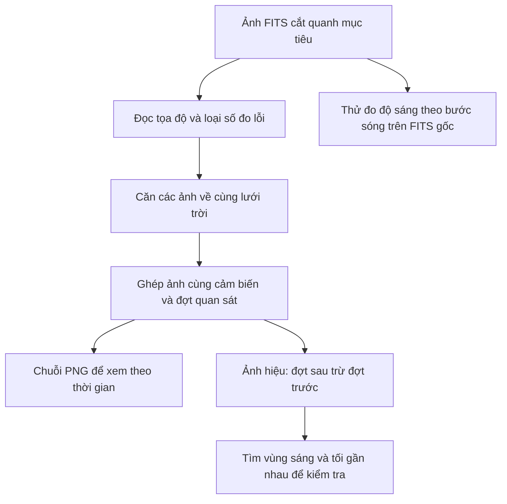

# Hữu Hoàng — từ ảnh bầu trời đến kết quả so sánh

Công việc của Hữu Hoàng là biến các ảnh hồng ngoại SPHEREx thành chuỗi ảnh có thể so sánh theo thời gian, đồng thời kiểm tra dữ liệu nào dùng được. Một nhánh thực hành khác thử đo độ sáng theo bước sóng để hỗ trợ phần khoa học khi đổi vai.

Đọc trang này trước để nắm bức tranh chung. [Nhật ký thực hiện và minh chứng](PROCESSING_GUIDE.md) giải thích từng bước, thông số, ảnh và giới hạn chi tiết.

## Luồng công việc của mình



FITS là file chứa số đo và thông tin tọa độ của ảnh thiên văn. PNG là ảnh để xem. Đo độ sáng cần dùng FITS gốc; màu sắc PNG đã được điều chỉnh cho dễ nhìn.

## Những phần đã làm

| Công việc | Mục đích | Kết quả hiện có | Giới hạn cần nhớ |
| --- | --- | --- | --- |
| **Căn ảnh về cùng tọa độ** | Để ảnh xoay/lệch không bị nhầm thành sao chuyển động | Có lưới chung và kiểm vị trí nguồn nền trên ảnh thật | Chưa xác nhận phát hiện WISE 0855 |
| **Ghép ảnh và tạo ảnh hiệu** | Tạo khung xem theo đợt và làm nổi chỗ khác nhau | Có ảnh ghép trung vị, số ảnh đóng góp và ảnh hiệu | Khác bước sóng, nền hoặc hình dạng nguồn vẫn có thể tạo vệt |
| **Xử lý bộ năm mục tiêu** | Áp dụng cùng quy trình, kiểm cờ chất lượng và ghép màu giả | 78 ảnh đầu vào → 39 ảnh ghép; từ ảnh ghép tạo 24 ảnh hiệu và 13 ảnh màu | Các số đếm là ảnh, không phải số nguồn phát hiện; không cộng các cột để đối chiếu đầu vào |
| **Dựng và kiểm tra chuỗi ảnh** | Chạy trọn đường từ dữ liệu đã tải đến sản phẩm có thể bàn giao | WISE 0855: 9 ảnh ghép, 6 ảnh hiệu; Barnard: 6 ảnh ghép, 3 ảnh hiệu | Thời gian chạy máy không thay bài tự dựng trong 90 phút |
| **Kiểm tra ảnh và tìm vùng thay đổi** | Hiển thị rõ dữ liệu thiếu và khoanh ứng viên để kiểm | Đã sửa màu vùng thiếu; demo tìm cặp sáng–tối trên 9 ảnh hiệu thật | 58 cặp ứng viên chưa phải 58 nguồn hay phát hiện chuyển động |
| **Đo phổ thực hành cho Luhman 16** | Thử đo độ sáng theo bước sóng khi hỗ trợ phần khoa học | 18 FITS thật: nền gần cho 0 mẫu đạt; nền xa cho 5 mẫu đo sơ bộ | Chưa có phổ được kiểm khoa học, chưa xác nhận bài đổi vai |

Màu tím ở ảnh độ sáng/ảnh hiệu là số đo thiếu hoặc bị loại. Các cờ thông tin như `SOURCE` (vị trí nguồn đã biết) không tự biến pixel thành dữ liệu lỗi; màu của bản đồ cờ phải đọc theo chú giải riêng.

## Muốn xem kết quả thì mở gì?

| Muốn hiểu điều gì? | File nên mở |
| --- | --- |
| Toàn cảnh năm mục tiêu | [Ảnh tổng quan](../../data/target_observations/target_observations_overview.png) và [bảng kiểm tra sản phẩm](../../data/target_observations/product_verification.json) |
| Ảnh đã căn có giữ nguồn nền đúng chỗ? | [Minh chứng căn ảnh](../../data/wise0855_alignment/background_source_alignment_check.png) |
| Chuỗi ảnh thật của Barnard | [Ảnh ghép đầu tiên](../../data/observation_products/image_series/barnard/detector_3_visit_00.png) và [ảnh hiệu](../../data/observation_products/image_series/barnard/detector_3_visit_01_minus_detector_3_visit_00.png) |
| Mỗi mục tiêu tạo bao nhiêu ảnh, chạy mất bao lâu? | [Báo cáo dựng chuỗi ảnh](../../data/observation_products/image_series/image_series_report.json) |
| Đã sửa cách hiển thị vùng thiếu ra sao? | [Ảnh trước/sau](../../data/observation_products/change_candidates/missing_data_display_comparison.png) |
| Các cặp sáng–tối được tìm như thế nào? | [Hình minh chứng](../../data/observation_products/change_candidates/signed_change_candidates.png) và [danh sách ứng viên](../../data/observation_products/change_candidates/change_candidates_report.json) |
| Vì sao phép đo nền gần không dùng được? | [Ảnh kiểm tra nền](../../data/observation_products/luhman16_spectrum/local_background/background_selection_check.png) và [báo cáo loại mẫu](../../data/observation_products/luhman16_spectrum/local_background/spectrum_extraction_report.json) |
| Thử nền xa hơn thu được gì? | [Năm mẫu đo sơ bộ](../../data/observation_products/luhman16_spectrum/wide_background/spectrum_samples.png) và [báo cáo thí nghiệm](../../data/observation_products/luhman16_spectrum/wide_background/spectrum_extraction_report.json) |

Các sản phẩm trong `data/` có trên máy đã chạy và không đưa lên Git. Tên `D1`, `D3`, `D6` trong file là **cảm biến số 1, 3, 6**, không phải mã nhiệm vụ; `visit00` là nhóm thời gian đầu tiên, không tự là survey chính thức.

## Mã và dữ liệu được tổ chức thế nào?

| File mã | Việc thực hiện |
| --- | --- |
| [align_sky_images.py](align_sky_images.py) | Căn ảnh, kiểm nguồn nền và đo tốc độ tái chiếu |
| [combine_observation_frames.py](combine_observation_frames.py) | Hàm ghép ảnh trung vị, lưu số ảnh đóng góp, PNG và ảnh hiệu |
| [process_target_observations.py](process_target_observations.py) | Tải mẫu quan sát, xử lý năm mục tiêu và ghép màu giả |
| [verify_observation_products.py](verify_observation_products.py) | Đọc lại sản phẩm năm mục tiêu để kiểm và tạo ảnh tổng quan |
| [build_image_series.py](build_image_series.py) | Dựng lại chuỗi ảnh WISE 0855/Barnard và kiểm kết quả |
| [analyze_observations.py](analyze_observations.py) | Tìm ứng viên thay đổi hoặc thử đo mẫu theo bước sóng |
| [test_image_processing.py](test_image_processing.py), [test_observation_analysis.py](test_observation_analysis.py) | Kiểm phép căn, phép trừ, mask, đo khẩu độ và ca giả lập |

```text
data/
  wise0855_two_epoch_comparison/ so sánh hai ảnh WISE 0855 ban đầu
  wise0855_alignment/            dữ liệu và kiểm tra căn ảnh ban đầu
  target_observations/           dữ liệu đầu vào và kết quả bộ mục tiêu
    luhman-16/                 dữ liệu mới dùng thử đo theo bước sóng
  observation_products/       kết quả thực hành được đặt tên theo công việc
    image_series/              chuỗi ảnh, ảnh hiệu và báo cáo dựng ảnh
    change_candidates/         minh chứng hiển thị và ứng viên thay đổi
    luhman16_spectrum/
      local_background/        đo thử bằng nền gần, kèm lý do loại mẫu
      wide_background/         thí nghiệm nền xa, kèm 5 mẫu sơ bộ
    reference_snapshots/       bản chụp tài liệu đầu vào để đọc offline
```

`observation_manifest.json` liệt kê ảnh **đầu vào**, gồm định danh quan sát, thời điểm, đường dẫn và mã kiểm nội dung. `image_series_report.json` ghi kết quả dựng chuỗi ảnh; `change_candidates_report.json` ghi ứng viên thay đổi; `spectrum_extraction_report.json` ghi phép đo theo bước sóng. `detector_1_frame_report.json` ghi riêng kết quả cảm biến số 1; không phải báo cáo nhiệm vụ. `spectrum_samples.ecsv` là bảng mẫu đo, kể cả mẫu bị loại và lý do.

## Chạy lại công việc

Chạy tại gốc repo trong PowerShell, với môi trường Python đã cài. Dựng ảnh/tìm thay đổi cần bộ dữ liệu năm mục tiêu đã tải.

```powershell
# Dựng chuỗi ảnh thật và kiểm đầu ra.
.venv/Scripts/python.exe members/huu-hoang/build_image_series.py

# Tìm ứng viên thay đổi từ ảnh hiệu vừa dựng.
.venv/Scripts/python.exe members/huu-hoang/analyze_observations.py find-changes

# Đo thử Luhman 16 trên dữ liệu đã tải: nền gần rồi thí nghiệm nền xa.
.venv/Scripts/python.exe members/huu-hoang/analyze_observations.py extract-spectrum
.venv/Scripts/python.exe members/huu-hoang/analyze_observations.py extract-spectrum --wide-background

# Nếu chưa có dữ liệu Luhman 16, thêm --download; lệnh này dùng mạng.
.venv/Scripts/python.exe members/huu-hoang/analyze_observations.py extract-spectrum --download

# Kiểm tra mã.
.venv/Scripts/python.exe -m pytest members/huu-hoang/test_image_processing.py members/huu-hoang/test_observation_analysis.py -q
```

Lệnh tải/căn ảnh ban đầu và xử lý đủ năm mục tiêu nằm trong [nhật ký chi tiết](PROCESSING_GUIDE.md). Thư mục có tên mã nhiệm vụ cũ đã được hợp nhất và bỏ sau khi rỗng. Các file của lần chạy trước nằm trong `previous_runs/initial_run/` bên trong phần việc tương ứng, với tên file rõ nghĩa; đây không phải bộ quan sát độc lập. Không có file FITS nào bị xóa khi tổ chức lại.

## Phần mình cần nhận và bàn giao

- **Nhận từ Khôi/Đông:** FITS thật cùng danh sách ảnh, thời điểm, cảm biến, phiên bản dữ liệu và cách truy nguồn. Khi chưa nhận, dùng bộ tự tải và ghi rõ đó là demo.
- **Nhận từ Nguyên:** quy tắc chọn ảnh so sánh được, cách đo nền/nguồn và checklist khoa học. Tài liệu đã có được dùng làm đầu vào; phần chưa được xác nhận vẫn ghi chờ kiểm.
- **Hữu Hoàng bàn giao:** PNG/FITS, ngày chụp, cảm biến, vùng thiếu, báo cáo kiểm và thông số đã dùng. Năm mẫu đo theo bước sóng cần gửi Nguyên kiểm nền, nguồn và hiệu chỉnh trước khi kết luận.

Việc tiếp theo của mình là xử lý issue ảnh có cách tái hiện cụ thể, kiểm phương pháp nền cho Luhman 16 và tự thực hành dựng lại/đổi vai có bấm giờ. Tiến độ hoặc sản phẩm của người khác không được tính thành phần mình đã hoàn thành.
